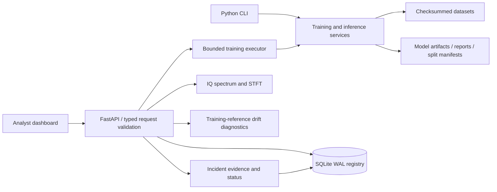

# Architecture and expansion plan

## Implemented runtime

All dashboard figures and tables use API results. No artificial live fleet counts or field accuracies are displayed. Signal examples are labeled synthetic. The frontend is static JavaScript served by the same API origin, with no third-party CDN or frontend build requirement.

### Data ownership

- SQLite owns dataset, model, training-job and incident metadata.
- Dataset CSVs are canonicalized and content-hashed. Training refuses a changed dataset.
- A successful model artifact includes the fitted preprocessing pipeline, optional anomaly detector, drift reference, feature schema and training statistics.
- Models publish to the registry after their artifacts are written; split indices and test reports live alongside each artifact.
- Inference checks the artifact path and SHA-256 before loading it. The registry is trusted local state; filesystem write access to the registry remains privileged.
- Runtime artifacts and raw datasets are ignored by Git. No telemetry is sent to an external service.

### Job lifecycle

`queued → running → completed | failed`. A single embedded worker runs up to one job with two waiting slots. Jobs retain progress and errors in SQLite. Startup marks jobs left queued/running by an earlier process as failed. Restarted jobs require explicit resubmission. Shutdown waits for active work. This is not a durable distributed queue, and cancellation/resumption are not implemented.

### Evaluation contracts

The training module validates labels and complete class coverage before training. Groups take priority over stratification. A class missing from any partition causes a clear error instead of an automatically relaxed split. Exact feature duplicates are rejected. Class weights are computed within training estimators; test distribution is preserved.

The three candidate algorithms see identical partitions. Validation macro F1 selects one model. The final report contains test metrics for the winner; repeated manual experiments can still overfit a reused test set. Final scientific publication requires an independently locked external evaluation set and a predeclared selection protocol.

### Resource limits

- Browser CSV import: 20 MiB, 150,000 rows. CLI import bypasses these caps and remains memory-bound.
- IQ analysis: 256–131,072 samples; visualization uses at most the first 16,384 samples. Features use the accepted full recording.
- Prediction API: at most 512 observations per request.
- Drift analysis: 50–5,000 observations per request.
- Dashboard registry lists show the latest 100 records; overview totals count all records. Event lists are bounded. CSV export currently caps at 100,000 events.
- Feature extraction/classifier work is CPU-based. PyTorch uses CUDA if available.
- Single-process API deployment. A proxy should enforce its own body-size and request-rate limits before remote deployment. Upload reads are bounded in application code, but multipart parsing can still spool the incoming body.

## Production scale migration (planned, not implemented)

| Component today | Scale migration | Acceptance criterion |
|---|---|---|
| SQLite record store | PostgreSQL with typed schemas and migrations | Concurrent ingest/read tests, backup restore drill, tenant isolation |
| Embedded executor | Redis/RabbitMQ queue with isolated CPU/GPU workers | Retry, cancellation, idempotency and crash recovery tests |
| Local artifact files | S3-compatible object store plus retention policy | Immutable model versioning, checksums, recoverability |
| Shared API key | OIDC login, organization roles and scoped service identities | Authorization matrix and auditable changes |
| Manual captures | Receiver agents with timestamps, capture metadata and buffered ingest | Clock alignment, backpressure, authenticated transport |
| Manual model choice | Promotion gate and signed deployment bundles | Locked benchmark, rollback and compatibility verification |
| Local logs | Structured tracing, health metrics and alerting | Measured latency/error budgets and observability under load |

Suggested next research additions are temporal models for receiver sequences, cross-receiver evaluation, calibrated probabilities, OOD evaluation using unseen interference families, and robustness studies across SNR/sample-rate settings. These require real datasets and an explicit validation protocol. They are not advertised as implemented features.
